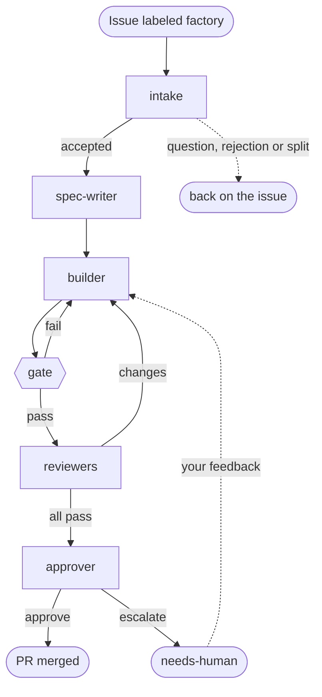
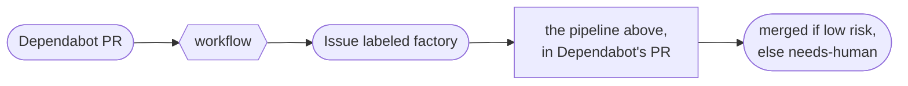

# Software factory template

A Claude Code software factory you install into a repository: `/factory run`
builds every open issue labeled `factory`, on GitHub or Gitea, through
intake → spec → build → gate → review → approve, one pull request per issue.

## How a job runs



| Step | What it does |
|---|---|
| **intake** | Decides whether the issue is worth building and at what scope, and rates its risk. Asks the author when it can't tell. |
| **spec-writer** | Turns the issue into `spec.md` with testable acceptance criteria. |
| **builder** | Implements the spec on its own branch and worktree, and opens a draft PR. |
| **gate** | A script, not an agent: `factory/checks.sh`, protected paths, and the integration tests the branch touched. |
| **reviewers** | Code review always; UX, UI and security reviews when the change calls for them. In parallel. |
| **approver** | Merges the PR (after syncing with the base, the gate again and the PR's CI checks), or hands it to a person. |
| **needs-human** | The PR is ready for review with a comment saying what to decide. Merge it, or tell the factory what to change. |

- **Agents judge, scripts decide.** Every step that can be checked by a program
  is one: routing, the gate, state changes and the merge are scripts, so an
  agent can't talk its way past a failing check, and a branch can't change the
  checks it is judged by (the gate runs the base checkout's copy).
- **Nothing is reviewed until it passes.** Reviewers only start on a build the
  gate passed.
- **Rounds are bounded.** One build → gate → review pass is a round. After
  `max_rounds` (default 3) the job goes to a person instead of looping.
- **A person is the fallback, never a step.** A job merges with nobody
  involved, or it stops at `needs-human` with the PR ready and a comment saying
  what to decide.
- **One session runs every job**, `concurrency` at a time (default 3), each in
  its own git worktree and branch. All state is files in `factory/jobs/`, so
  when the session dies, `/factory run` picks every job back up.

### Optional: Dependabot PRs

Installed with `--dependabot`. The factory only picks up issues, so a workflow
opens one for each Dependabot PR. The job then works inside Dependabot's own
PR rather than opening a second one.



## Install

In the repository you want the factory in, tell Claude Code:

```text
Install the software factory by following /path/to/factory-template/INSTALL.md
```

That document is the whole install; there is nothing to run by hand. The agent
copies the files, fills every `ADAPT:` placeholder (the project description,
security hot spots, design system, users, testing rules, always-human areas),
writes `factory/checks.sh`, sets up the integration tests and
`factory/config.json`, creates the labels, verifies and commits. It asks
whether you want the two optional sets:

- **cloud**: run the factory in Claude Code cloud sessions.
- **dependabot**: have the factory build Dependabot's PRs.

To upgrade an installed factory, say `Upgrade the software factory following
/path/to/factory-template/INSTALL.md`. It replaces the engine (`factory/bin`,
`factory/tests`, the dashboard, the skill) and keeps what the repo adapted.

## Platforms

Linux, macOS and Windows. The scripts are Python 3.10+ with only the standard
library; `factory/bin/portable.py` holds what differs between platforms (file
locks, stopping a process tree, finding bash, text encoding). On Windows the
factory needs Git for Windows: Claude Code runs its commands in Git Bash, and
`factory/checks.sh` runs there too. Integration tests need no shell; their
command is set per platform in `factory/config.json`.

## GitHub or Gitea

A repository uses one of them, set as `forge` in `factory/config.json`.
GitHub is the default and goes through the `gh` CLI. For Gitea (or Forgejo)
set `{"type": "gitea", "url": "https://git.example.com"}` and put an access
token in the `GITEA_TOKEN` environment variable; nothing else is installed.
On Gitea a draft pull request is one whose title starts with `WIP:`, checks
are read from commit statuses, and split issues name their parent in their
text, since Gitea has no sub-issues. Gitea records no reason for closing an
issue, so a closed issue counts as done only with the `factory:completed`
label, which the factory adds when the issue's PR merges. The Dependabot and
cloud sets need GitHub.

`.github/workflows/test.yml` runs the factory's tests on all three.

## Layout

| Path                                       | What                                                                               |
| ------------------------------------------ | ---------------------------------------------------------------------------------- |
| `template/.claude/skills/factory/SKILL.md` | The orchestrator: the session that runs `/factory`                                 |
| `template/.claude/agents/`                 | intake, spec-writer, builder, four reviewers, approver                             |
| `template/factory/bin/job`                 | The only writer of job state; every GitHub or Gitea call                           |
| `template/factory/bin/gate`                | The deterministic gate: `checks.sh`, protected paths, integration tests            |
| `template/factory/bin/route`               | Risk and surfaces → models and reviewers                                           |
| `template/factory/bin/store`               | Publishes job state to a branch; serves the remote dashboard                       |
| `template/factory/bin/portable.py`         | What differs between Linux, macOS and Windows                                      |
| `template/factory/bin/gitea.py`            | Gitea and Forgejo, answered in the shape of GitHub's API                           |
| `template/factory/checks.sh`               | Placeholder for the repo's checks                                                  |
| `template/factory/config.json`             | Concurrency, rounds, labels, routing, prices                                       |
| `template/factory/tests/`                  | The factory's own tests (stdlib `unittest`)                                        |
| `optional/cloud/`                          | Claude Code cloud environment: setup script, SessionStart hook, `factory/CLOUD.md` |
| `optional/dependabot/`                     | Workflow that opens one `factory` issue per Dependabot PR                          |

## What this adds to the original

- **Cloud sessions.** Every GitHub call is `gh api` on a REST path, because
  cloud sessions refuse GraphQL. Reviewers and the builder use the
  pre-installed Playwright when `agent-browser` isn't there. The gate starts
  `dockerd` when the session hasn't.
- **State store.** With `FACTORY_STATE_BRANCH` set, each save publishes the
  job's files to a branch, so a factory running in a cloud session can be
  followed from anywhere (`factory/bin/store serve`).
- **Proof in every PR.** The PR description must have a `## Proof` section
  showing the change working: real command output, screenshots or a
  recording. The script refuses a description without one, pushes the linked
  images to a `factory-proof` branch so they show in the PR, and the code
  reviewer and approver check the proof against the diff.
- **No lost work.** Every step can list work it leaves out under
  `## Follow-ups` in its own file. The script files each entry as a new
  `factory` issue before the PR merges, held until the first issue closes.
  There is no cap on how many, and a follow-up can have follow-ups.
- **No tool credit.** Commits and PR descriptions never carry a
  `Co-Authored-By:` trailer or a "Generated with" line.
- **Integration gate.** After `checks.sh`, the gate runs the repo's integration
  tests for the integration test files the branch changed (a command per
  platform in `factory/config.json`, no shell script),
  one job at a time across the machine, with a timeout and a retry on Docker
  Hub's pull rate limit.
- **Parallel-job safety.** Per-worktree locks on every gate mode, and a run
  whose output names another job's worktree fails.
- **Dependency update jobs.** A job can work inside Dependabot's own PR; the
  spec-writer reads the release notes and the approver classifies the update
  by risk.
- **Merging.** `job merge` syncs with the base, re-runs the gate, waits for the
  commit's CI checks, and sends conflicts back to the builder. `job update`
  brings a waiting branch up to date.
- **Job ids** are the issue number plus a title slug, so they never repeat
  between machines or sessions.
- **Windows.** The scripts run on Linux, macOS and Windows, and the
  integration tests are a command per platform, not a shell script.
- **Gitea.** A repository's issues and pull requests can be on Gitea or
  Forgejo instead of GitHub: set `forge` in `factory/config.json` and
  `GITEA_TOKEN` in the environment. The Dependabot and cloud sets stay
  GitHub only.
- **Tests** for `job`, `gate`, `store`, `portable` and `gitea`.

## Working on the template

```bash
(cd template && python3 -m unittest discover -s factory/tests)
```

Keep `template/` free of any one project's names and paths: what differs per
project goes behind an `ADAPT:` marker or into `factory/config.json`.
